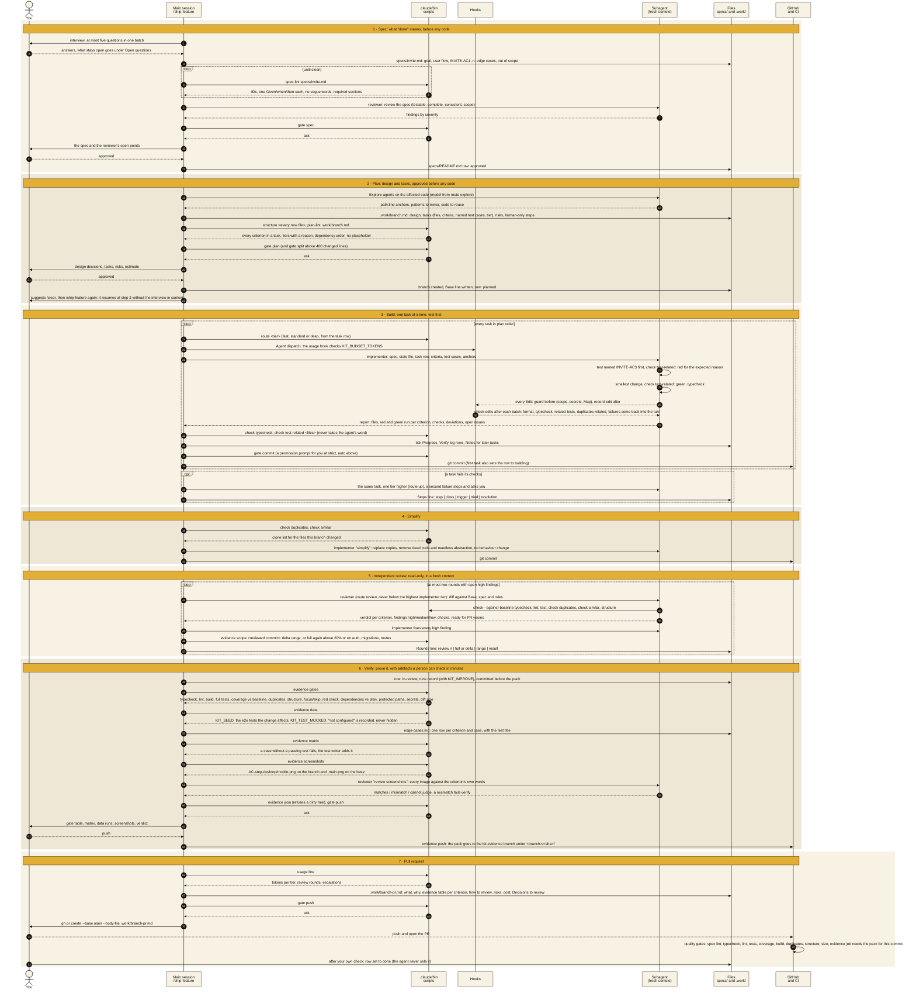
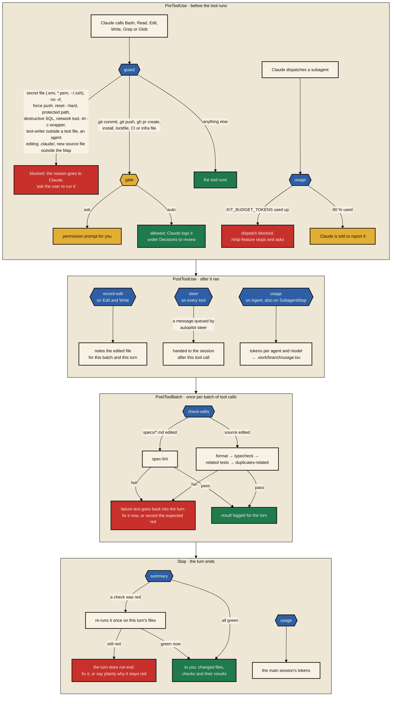

<p align="center">
  <a href="https://github.com/vitoleonardo/stempel-kit"></a>
</p>

<p align="center">
  <a href="https://github.com/vitoleonardo/stempel-kit/actions/workflows/stempel-kit.yml"></a>
  <a href="https://github.com/vitoleonardo/stempel-kit/actions/workflows/repo-check.yml"></a>
</p>

<p align="center">
  <a href="./plugins/stempel-kit/"></a>
  <a href="./plugins/repo-check/"></a>
  <a href="./LICENSE"></a>
  <a href="https://github.com/vitoleonardo/stempel-kit/commits/main"></a>
</p>

<p align="center">
  <a href="https://code.claude.com/docs"></a>
  
  
  <a href="https://vito.koeln/"></a>
  
</p>

<h1 align="center">Stempel Kit</h1>

<p align="center"><strong>Nothing ships without a stamp.</strong></p>

Claude Code writes code fast. Out of the box, nothing makes it write down what "done" means, test before it builds, keep away from `.env` and `git push --force`, or prove its work before a pull request. Stempel Kit puts the rules, the workflow and the checks into your repository as plain Markdown, JSON and POSIX shell, so every session and every developer works the same way and CI enforces what the agent promised. Built for [Claude Code](https://code.claude.com/docs), MIT licensed.

A *Stempel* is a rubber stamp. Every feature collects five of them before it merges, and each one is a file or a check, not a chat message:

| Stamp | Who sets it | What it proves |
|---|---|---|
| **Spec approved** | `spec-lint`, the reviewer, you | A spec in `specs/` with a user flow and numbered acceptance criteria. Vague words ("fast", "user-friendly") are rejected before anyone approves |
| **Plan approved** | `plan-lint`, you | Every criterion has a task and a named test, new files sit in the Map, nothing is left as a placeholder |
| **Tests red, then green** | `test-writer`, `implementer`, the hooks | Each criterion gets a test that fails first. Format, typecheck, related tests and the duplicates check run after every batch of edits, and the turn does not end quietly while they are red |
| **Review passed** | `reviewer` | A read-only reviewer in a fresh context, with a verdict per criterion and findings by severity |
| **Evidence sealed, CI green** | `/verify-feature`, the quality gates | An evidence pack on the commit: red run, green run, edge-case matrix, coverage of the changed files. CI repeats spec lint, typecheck, lint, tests, coverage, build and duplicates, against a baseline in legacy repositories |

## How it works


Mustard is a person, blue an agent in its own context, the hexagons are hard gates that fail the turn, green is the merge. With `KIT_APPROVAL=standard` the agent pushes and opens the pull request itself unless the branch touches auth or migration files; with `autonomous` it also approves the spec and the plan, and every decision it took is listed in the PR under "Decisions to review". A backlog of approved specs runs unattended with `.claude/bin/autopilot`, one fresh headless session per feature on stacked branches. Bug fixes take the same path through `/fix-bug`, without a spec but with a red test before the fix. The [kit's README](./plugins/stempel-kit/README.md#how-a-feature-flows) walks through one feature step by step.

## What's inside

| | What it is | For |
|---|---|---|
| [**stempel-kit**](./plugins/stempel-kit/) | Plugin and installer | Existing projects in any language: spec-driven workflow, permissions, guard and check hooks, subagents, CI gates, onboarding for legacy repositories with a baseline, model routing with token budgets, lead time measurement, an unattended autopilot. Adapters for TypeScript and Python |
| [**repo-check**](./plugins/repo-check/) | Plugin or single-file prompt | Any repository: finds where delivery is jammed right now (writing, review or release), by a 10-minute interview or a strictly read-only scan. Sends nothing |

### Which one do I need?

- **You want to know where AI agents would help your team most:** start with `repo-check`. It takes ten minutes and changes nothing.
- **You have a codebase and want agents to work in it under rules:** install `stempel-kit`.
- **You want the same rules in many repositories:** install the plugin from the marketplace and the project files with `install.sh --plugin`.

## A feature, step by step

`/ship-feature` runs in the main session and orchestrates. It never writes product code itself: it dispatches subagents in fresh contexts, asks the scripts in `.claude/bin` for every decision a script can make, and records each step in a file, so a new session resumes where the last one stopped. The diagram shows one feature at the default level (`KIT_APPROVAL=strict`), where every gate asks you.



What you see at each gate depends on `KIT_APPROVAL`: `strict` (the default) asks at every gate; `standard` asks for the spec and the plan and does the rest alone; `autonomous` does everything alone. Every decision taken at an `auto` gate lands under "Decisions to review" in the state file and in the PR body, so a reviewer sees what nobody approved. Three things never change with the level: the guard still blocks secrets, protected paths and destructive git; `gh pr merge` and edits to `.claude/` still ask; and a failure that comes back after two fixes stops and asks.

Each phase leaves a file, and those files are the whole memory of the run:

| File | Written by | Holds |
|---|---|---|
| `specs/README.md` | spec, plan, build, verify, you | One row per feature: spec file, status (`draft` → `approved` → `planned` → `building` → `in-review` → `done`), branch, open questions |
| `specs/<feature>.md` | `/spec-feature` | Goal, user flow, numbered criteria, edge cases, out of scope, open questions, dated decisions. Never changed during a build |
| `.work/<branch>.md` | `/plan-feature`, then every step | Design, task table, risks, human-only steps, Progress, Verify log (red and green run per criterion), Stops, Rounds, Decisions to review, Notes between tasks |
| `.work/<branch>/evidence/` | `/verify-feature` | `gates.md`, `data-runs.md`, `edge-cases.md` and `matrix.tsv`, screenshots, `screenshots-review.md`, `review.md`, `evidence.json` for one commit |
| `kit-evidence` branch | `evidence push` | The pack of every verified commit, so CI and a reviewer can read it without the author's machine |
| `.work/<branch>-pr.md` | `/pr-description` | The PR body |
| `.work/<branch>/usage.tsv`, `agents.tsv` | the usage hook | Tokens per agent and model; which agent ran which task |
| `reports/runs/<branch>.tsv`, `reports/runs.md` | `runs record`, `runs report` | With `KIT_IMPROVE`: one record per feature (tokens per tier, escalations, review rounds, every stop) and the report across runs |
| `.work/autopilot/` | `autopilot` | Run log, `sessions.tsv`, every headless transcript, the lock, queued steering messages |

`.work/` is gitignored. The spec, the feature row, the run records and the evidence branch are the parts that survive.

## What the hooks do around every tool call

The skills describe the workflow; the hooks enforce it, in every session, also in a headless one. They are POSIX shell, wired in `.claude/settings.json` (or shipped by the plugin), and they run on Claude Code's hook events:



Three details matter in practice. The guard decides approval gates itself: it answers the permission check with `ask` or `allow` by `KIT_APPROVAL`, so a chained or substituted command (`a && b`, `$(…)`) always goes through the normal prompt. The check hooks run only the commands `.claude/kit.conf` defines, through `.claude/bin/check`, so they are as fast as your typecheck. And a red check does not fail the turn silently: the Stop hook holds the session once, which is why a test written to fail first has to be recorded as such in the state file.

## Features in detail

The kit, `plugins/stempel-kit`, as it is installed into a project. The parts under [Group sessions, stacks and risk](#group-sessions-stacks-and-risk) came with version 0.4.

### Skills

| Skill | What it does | Ends with |
|---|---|---|
| `/ship-feature <idea>` | Runs spec, plan, build, simplify, review, verify and PR with the gates above. Resumes from `.work/<branch>.md`, so a break or a new session costs nothing | A PR description and, at `auto`, the open PR. The row stays `in-review` until you set `done` |
| `/spec-feature <idea>` | Finds the spec to extend (one feature, one spec), interviews you in one batch of at most five questions, writes the spec from a fixed template, runs `spec-lint`, has the reviewer check it, sets the row to `draft` | Gate `spec`: `approved`, or the open questions back to you. Criterion IDs are never renumbered; a dropped one is marked `removed` |
| `/plan-feature <feature>` | Refuses a spec that is not `approved`. Explores the code with `Explore` agents, writes design, tasks with files, criteria, named test cases and a model tier each, risks and human-only steps. Runs `structure` for every new file and `plan-lint` | Gate `plan` (and `split` above 400 changed lines): `planned` |
| `/fix-bug <issue, report or failing test>` | A feature with a smaller plan. The report becomes one to three criteria: a spec's own criterion, one new criterion added to the spec (gate `spec`), or plan-only criteria when no spec covers the area. The test-writer writes the red test, the implementer the fix, one commit, then the same review, verify and PR. Never sets a feature's status | A PR whose Why links the report, not a spec |
| `/write-tests` | The test-writer on its own: tests named by criterion, red first, edge cases, mocks only at the boundaries | A list of which tests failed first and which passed without ever failing |
| `/review-diff [base]` | The reviewer on its own, against the spec and the rules | Verdict per criterion, findings by severity, ready for PR yes or no |
| `/verify-feature [base]` | Hard gates, data runs, the edge-case matrix, screenshots on the branch and the base, the reviewer's screenshot verdict, the pack | Gate `push`: the pack on the `kit-evidence` branch |
| `/pr-description [base]` | Title, what, why, an evidence table per criterion, how to review it in five minutes, risks, the cost line, Decisions to review. Refuses a stale pack | Gate `push`: the `gh pr create` command, or the PR |
| `/onboard [--refresh]` | Four passes for an existing repository: scan, baseline, proposal, apply. Writes nothing outside `.work/onboard/` until you approve; `.claude/bin/onboard-apply` puts the files in place and refuses a looser baseline | `kit.conf` per package, project facts, the Map, rules from the repository's own conventions, protected paths, `.claude/baseline.tsv`, the lead-time baseline |
| `/improve-kit [focus]` | Optional, human-started. Reads the run records, token usage and lead time, checks whether earlier kit changes moved their metric, applies fixed rules with minimum samples | Proposals in `.work/improve/<date>.md`; nothing changes before you pick |

### Subagents

| Agent | Context | May | May not | Returns |
|---|---|---|---|---|
| `implementer` | One task, fresh; everything it needs is in the spec, the state file and the task row | Read, Grep, Glob, Edit, Write, Bash | Commit, push, switch branches, edit `.claude/`, change an approved spec, touch files outside the task without reporting it | Files changed, red and green run per criterion, checks, screenshots checked, deviations, open issues |
| `test-writer` | One criterion, case or diff | Edit test files only (the guard enforces `KIT_TEST_PATTERNS`), read-only git, `.claude/bin/check` | Change product code; it reports what a testable design needs instead | Tests written, which failed first, which passed without failing, criteria covered |
| `reviewer` | A diff, a spec or a screenshot folder; `effort: high` | Read, Grep, Glob, read-only git, `check`, `spec-lint`, `structure` | Edit anything | Criteria table, findings high/medium/low with `path:line`, checks, ready for PR |

Every dispatch carries a model from `.claude/bin/route`, because the Agent tool's `model` parameter wins over an agent's frontmatter: `KIT_MODEL_FAST`, `KIT_MODEL_STANDARD` and `KIT_MODEL_DEEP` (`haiku`, `sonnet`, `opus` by default) and one route per role (`explore` fast, `implement` and `tests` standard, `review` deep). A task that fails once is retried one tier higher; the reviewer never runs below the highest tier an implementer used.

### Hooks and permissions

| Event | Hook | What it does |
|---|---|---|
| `PreToolUse` on Bash, Read, Edit, Write, Grep, Glob | `guard` | Blocks secret files, `rm -rf`, force push, `git reset --hard`, `git clean`, branch deletion, destructive SQL, network tools and the `sh -c`, `/usr/bin/env` and `git -C` wrappers the deny list cannot see. Blocks commands and reads on `KIT_PROTECTED_PATHS`, the test-writer outside test files, agents editing `.claude/`, and a new source file outside the Map. Decides the `commit`, `push`, `deps` and `config` gates by `KIT_APPROVAL` |
| `PreToolUse` on Agent | `usage` | Warns at 80 % of `KIT_BUDGET_TOKENS`, blocks the dispatch at 100 % |
| `PostToolUse` on Edit, Write | `record-edit` | Notes the file for the batch and the turn |
| `PostToolUse` on Agent, `SubagentStop`, `Stop` | `usage` | Reads the transcripts and writes tokens per agent and model to `.work/<branch>/usage.tsv` |
| `PostToolUse` on everything | `steer` | Hands an autopilot session the messages queued with `autopilot steer` |
| `PostToolBatch` | `check-edits` | `spec-lint` for edited specs; format, typecheck, related tests and `duplicates-related` for edited sources; failures go back into the turn |
| `Stop` | `summary` | Re-runs a red check once and holds the turn while it stays red; otherwise reports changed files and check results |

`.claude/settings.json` sets the permissions underneath: read-only git and the kit's own scripts run without asking; `gh pr merge` and edits to `settings.json`, `kit.conf`, the baseline, the hooks, the scripts and the rules always ask, so the agent cannot raise its own level; reading `.env*`, keys and `~/.ssh`, `sudo`, `rm -rf`, force pushes, `curl`, `wget`, `ssh` and `printenv` are denied. For OS-level isolation `/onboard` can turn on Claude Code's sandbox with `denyRead` on protected paths; without it these layers are best effort.

### Gates and approval levels

`.claude/bin/gate <name>` answers `ask` or `auto` from `KIT_APPROVAL` in `.claude/kit.conf` or the environment (`KIT_APPROVAL=autonomous claude` for one session). `KIT_GATE_<NAME>` overrides one gate.

| Gate | Covers | `strict` (default) | `standard` | `autonomous` |
|---|---|---|---|---|
| `spec` | approving the spec, and again after an amendment | ask | ask | auto |
| `plan` | approving the plan | ask | ask | auto |
| `split` | splitting a change past `KIT_MAX_CHANGED_LINES` into several PRs | ask | auto | auto |
| `deps` | new dependencies, installs, lockfiles | ask | auto | auto |
| `config` | `.github/`, CI files, Dockerfiles, compose, `migrations/`, `infra/`, `terraform/` | ask | auto | auto |
| `commit` | `git commit` on a feature branch | ask | auto | auto |
| `push` | `git push`, `gh pr create`, `evidence push` | ask | auto | auto |

`push` still asks at every level when the branch changes a file in `KIT_PUSH_ASK_PATTERNS` (the adapters set auth and migrations), so a person approves those while a plain UI change goes out alone. A commit on `main` always asks. Failed verify rounds go through `gate round <class> <n>`: a `kit` false positive never counts as a round, `test` and `hotfix` rounds continue up to `KIT_VERIFY_ROUNDS` (`test:3 hotfix:2`, and past it at `autonomous`), a `spec` change always asks. Every retry and stop is one line under Stops with its class (`spec`, `plan`, `tier`, `test`, `hotfix`, `kit`, `env`, `budget`), which is what `/improve-kit` later counts.

### Scripts in `.claude/bin`

| Script | What it does |
|---|---|
| `check <typecheck\|lint\|test\|test-related\|coverage\|format\|build\|duplicates\|similar> [files]` | One entry point for every check. The commands come from `.claude/kit.conf` (a package in a monorepo can have its own); a missing one reports "not configured", never a guess. `--against-baseline` blocks only failures that are not in `.claude/baseline.tsv` |
| `spec-lint <spec>` | Criterion IDs, exactly one Given/when/then each, one result per criterion, no vague words, required sections, no open questions once approved |
| `plan-lint <plan>` | Every criterion in a task, no unknown IDs, named test cases, a reason per raised tier, dependency order, new files in the Map, no placeholder left |
| `structure <files>` | Every new source file sits in a home of the Map in `.claude/rules/structure.md`; no file named `utils`, `helpers`, `common` or `misc` |
| `gate <name>`, `gate level`, `gate round` | The approval decisions above |
| `route <role\|tier>`, `route up`, `route check` | The model for a dispatch; one tier up; a warning when `CLAUDE_CODE_SUBAGENT_MODEL_FORCE` overrides routing |
| `usage report\|line\|adopt\|tsv` | Tokens per agent, the PR's cost line, moving a branch's record, the raw table. The next kit adds `cache` and `cost` |
| `baseline record` | Every configured test, lint, typecheck and coverage command per package; test IDs from the JUnit report, errors per file |
| `evidence gates\|data\|matrix\|screenshots\|scope\|json\|push` | The verify steps, each one a script decision; `scope` says whether a later review round can be a delta |
| `status [--json] [--session <id>]` | `invite-users · build · tasks 3/7 · 1 red · budget 42%`, or the same as JSON with criteria, Stops, Rounds, decisions, evidence and the autopilot run. Writes nothing; Stempel Kit Pro's cockpit draws it |
| `leadtime [--baseline] [--split-by kit] [--with-titles]` | Lead time, PR cycle time, time to first review, review rounds, spec to merge, rework rate and PR size from GitHub, median and p75, before and after the kit, without names |
| `runs record\|report` | With `KIT_IMPROVE`: the per-feature record and the report across runs, tokens as tokens, never money |
| `autopilot [start] [slug …]`, `autopilot stop`, `autopilot steer "<text>"` | Builds every approved spec unattended, see [Run a backlog unattended](#6-run-a-backlog-unattended) |
| `onboard-apply [--accept-looser]` | Moves the staged onboarding files into the project; refuses a baseline looser than the current one unless you say so |

### Rules, project guide and CI

`CLAUDE.md` holds the project facts (product, stack, commands, what CI runs, human-only steps), the flow above and the working agreements: ask instead of filling gaps, report a skipped check plainly, never edit `.claude/` to make a check pass, stop after two failed fixes. `.claude/rules/` adds structure (the Map), architecture, testing, security, code style, git and output; a stack rule from the adapter loads only for matching files.

`.github/workflows/quality-gates.yml` repeats on every PR what the agent promised: spec lint, typecheck, lint, tests, coverage of the changed files (70 %), build, duplicates, structure and a warning above 400 changed lines, all against the baseline. The TypeScript adapter adds `evidence.yml`, which fails a PR whose head commit has no evidence pack, and a sticky comment with the screenshots. Make `quality-gates` a required status check.

### Adapters

The core is language-neutral: every check is a command in `.claude/kit.conf`. Two adapters fill them in and are tested in CI: TypeScript (presets for Next.js, NestJS and plain Node; jscpd 5 for duplicates) and Python with uv. Another language installs without an adapter and fills in the commands by hand, or lets `/onboard` find them.

### Group sessions, stacks and risk

Since 0.4 the kit keeps the spec and the plan and changes how the build runs:

| Part | What changes |
|---|---|
| Group sessions | The plan groups tasks. Each group runs in its own headless session on the group's tier, with its own commits, simplify and review; the build checks each group itself and stops on the budget. It goes on if you close the terminal |
| Stacked pull requests (`stack`) | One PR per group, linked as a GitHub stack (`gh stack`, or a chain without it), each with its own evidence pack and description; the size limit applies per layer |
| Stack stage (`stack checks`, `stack-checks.yml`) | The e2e tests the change affects, with screenshots, and mutation tests on the changed lines, once per stack as the last check before the merge |
| Risk rank (`risk`, `risk.yml`) | Ranks the plan and every layer. At the default `KIT_APPROVAL=autonomous` the build merges a low-ranked stack itself; a high rank (architecture change, auth or migration files, the build's own checks, very complex work) waits for you, and the `Risk` check holds the merge until you approve |
| E2e map | E2e tests are selected by a map from source paths to tests, not only by criterion IDs |
| Steering | `autopilot --steer "<text>"` and `--stop` reach the running build session through the `steer` hook |
| Cost visibility | `usage cache` shows the cache hit rate per agent and branch, `usage cost <feature>` what the autopilot sessions cost per phase, from Claude Code's own figures; the PR's cost line and the run log carry both, and name a rate below `KIT_CACHE_MIN_PERCENT`. `KIT_EFFORT_<TIER>` sets the reasoning effort of group sessions |

The kit's [README](./plugins/stempel-kit/README.md) and [build log](./plugins/stempel-kit/docs/build-log.md) have the details.

## How to use it

### 1. Install

Inside Claude Code, add the marketplace and the plugins:

```text
/plugin marketplace add vitoleonardo/stempel-kit
/plugin install repo-check@stempel-kit
/plugin install stempel-kit@stempel-kit
```

A plugin cannot ship permissions, rules, `kit.conf` or `CLAUDE.md`, so each repository also needs the project files:

```sh
git clone https://github.com/vitoleonardo/stempel-kit
cd stempel-kit/plugins/stempel-kit
./install.sh ~/code/my-app --adapter typescript --preset nextjs --plugin
```

Leave out `--plugin` and the installer puts skills, agents and hooks into the project too; then the plugin is not needed. The installer never overwrites a file that exists; it lists them for you to merge (`--force` overwrites). Then:

1. Fill in "Project facts" in `CLAUDE.md`.
2. Run `.claude/bin/check typecheck`, `lint`, `test`, `build` and `duplicates` once, to see that the adapter found your commands.
3. Start `claude` in the project and accept the trust prompt. Until then Claude Code ignores the project's hooks and allow rules.
4. Make the `quality-gates` workflow a required status check on GitHub.

Requirements: Claude Code 2.1.309 or later, git, a POSIX shell. The TypeScript adapter needs Node 20.9+ and `jscpd@5` as a dev dependency; the Python adapter needs uv and `jscpd` on PATH.

> **Renamed.** This repository was `agentic-development-template` and the kit was `agentic-workflow-kit`. Old links redirect and installed plugins keep working. To receive updates under the new name, run `/plugin marketplace remove agentic-development-template`, then the two commands above.

### 2. Bring in an existing repository

```sh
./install.sh ~/code/legacy-app        # no adapter
cd ~/code/legacy-app && claude
```

Then `/onboard`. It scans the repository, records the baseline of every check so tests that already fail never block a PR, and proposes `kit.conf` per package, the project facts, the Map, rules from your own conventions and protected paths. It writes only to `.work/onboard/` and waits for you after each pass; `.claude/bin/onboard-apply` puts the files in place. Commit them, accept the trust prompt, make CI required. Later, `/onboard --refresh` picks up new adapter keys.

### 3. Ship a feature

```text
/ship-feature Invite colleagues to a team by email
```

At the default level this is what happens on your side:

1. It asks at most five questions, writes `specs/invite.md`, lints it, has the reviewer check it, and shows you the spec. You approve, or answer the open questions.
2. It writes `.work/<branch>.md` with the design and the tasks and shows you the summary. You approve. It suggests `/clear` and `/ship-feature Invite …` again, which resumes at the build with a small context.
3. The build runs alone: one implementer per task, test first, hooks after every edit, a commit per task, then simplify and the review rounds. You are asked only when a task fails twice, a review does not converge, the budget is used up, or the spec turns out to be wrong.
4. Verify shows you the gate table, the edge-case matrix, the data runs and the screenshot verdict, and asks before pushing the pack.
5. It shows the PR description and offers the `gh pr create` command. You run it, read the PR (start with "Decisions to review" and the evidence table), merge, and set the row in `specs/README.md` to `done`.

The steps also run on their own: `/spec-feature`, `/plan-feature`, `/write-tests`, `/review-diff`, `/verify-feature`, `/pr-description`. A new session on an existing branch reads `specs/README.md` and the state file first and continues.

### 4. Fix a bug

```text
/fix-bug 123
/fix-bug "Deleting the last member leaves the team without an owner"
/fix-bug INVITE-AC4: duplicate email
```

An issue number, a pasted report or a failing test. It writes the plan with one to three criteria, has the test-writer reproduce the bug as a red test, the implementer fix it, commits both together, then reviews, verifies and writes the PR. A report that describes what the spec already says stops and asks; a report that asks for new behaviour is sent to `/spec-feature`.

### 5. Decide how much it asks

In `.claude/kit.conf`, or per session in the environment:

```sh
KIT_APPROVAL="standard"      # strict (default), standard or autonomous
KIT_GATE_PUSH="ask"          # override one gate
KIT_PUSH_ASK_PATTERNS="auth/* *auth.* migrations/*"   # pushes that always ask
KIT_BUDGET_TOKENS="2000000"  # per branch; the usage hook blocks past it
```

### 6. Run a backlog unattended

1. Approve every spec yourself; rows must be `approved`. Autopilot refuses to start on a draft.
2. Set `KIT_BUDGET_TOKENS`.
3. Start `claude` in the project once and accept the trust prompt; headless sessions in an untrusted folder get every check denied. Autopilot checks this with a one-turn session before it starts.
4. Run it:

```sh
.claude/bin/autopilot                 # every approved row, in file order
.claude/bin/autopilot export invite   # these two, in this order
.claude/bin/autopilot start           # detached; output in .work/autopilot/autopilot.out
.claude/bin/autopilot steer "Keep the invite form on one page"
.claude/bin/autopilot stop
```

Each feature gets a fresh plan session and a fresh build session at `KIT_APPROVAL=autonomous`, on a branch stacked on the previous feature's branch, so the PRs form a stack. A question a session cannot answer goes to a separate read-only session that answers from the approved spec (at most two per feature); a denied command, a `spec`, `hotfix`, `kit`, `env` or `budget` stop, or an escalation stops the run, and the printed `claude --resume <session id>` continues it. A watchdog ends a session after four hours, twenty idle minutes or six identical tool calls in a row and restarts the phase once; a usage limit is waited out. Review the run in this order: `.work/autopilot/run-<time>.md`, each PR's "Decisions to review" from the bottom of the stack up, then `reports/runs.md`.

### 7. See where things stand, and measure

```sh
.claude/bin/status            # invite-users · build · tasks 3/7 · 1 red · budget 42%
.claude/bin/status --json     # criteria, tasks, stops, rounds, decisions, evidence, the autopilot run
.claude/bin/leadtime          # lead time, cycle time, review rounds, rework, before and after the kit
.claude/bin/usage report      # tokens per agent and model on this branch
```

Set `KIT_IMPROVE="1"` to keep a record per feature; after five runs, `/improve-kit` reads them and proposes changes to the kit with the metric each one should move. Approved changes go on a `kit-improve-<date>` branch with a test, and `/improve-kit` checks after three more runs whether the metric moved.

### 8. Update the kit

```sh
git -C stempel-kit pull
./install.sh ~/code/my-app --update
```

Files you have not changed are replaced; files both sides changed are kept, with the kit's version in `.work/kit-update/` and a `diff` command per file. Commit `.claude/kit.manifest` with the update.

### 9. Try it first

[examples/demo-app](./plugins/stempel-kit/examples/demo-app/README.md) is a small Next.js app with a spec and tests. Install the kit into a copy, run `/ship-feature`, break a test on purpose and watch the hook catch it, ask for `rm -rf src` and watch the guard block it. About five minutes.

## Repository layout

```text
.claude-plugin/        marketplace: lists every plugin
plugins/
  stempel-kit/         kit/ (what gets installed), adapters/, install.sh, tests/, docs/, examples/demo-app/
  repo-check/          plugin/, the generated single-file prompt repo-check.md, build, tests/, docs/
.github/workflows/     one CI workflow per product
```

## How it is tested

Every product has its own CI workflow that runs on each pull request and on `main`; the badges at the top show the current state:

- **stempel-kit:** shellcheck over every script, sixteen test suites (hooks, spec lint, plan lint, installer, checks and baseline, evidence pack, routing and usage, lead time, run records, autopilot, structure map, status, steering, fix-bug skill, stacked layers, risk rank), and fourteen of them again under `dash`. The demo app is installed with the kit and must pass spec lint, typecheck, lint, tests, coverage and build.
- **repo-check:** shellcheck, the read-only hook, the scanner, and a drift test that fails when the single-file prompt or the bundled `leadtime` differs from its source. All under `dash` as well.

What the tests and real end-to-end runs caught while building each product is in its build log: [kit](./plugins/stempel-kit/docs/build-log.md), [repo-check](./plugins/repo-check/docs/build-log.md). The specifications behind them are next to the logs. Every change to the kit after a real run is in its [improvements log](./plugins/stempel-kit/reports/improvements.md), with the metric it should move and the value before, and `/improve-kit` checks each one after three more runs. What the tools cannot do is under the kit's [limits](./plugins/stempel-kit/README.md#limits).

## Security

The kit's guard hook and permissions reduce risk; they are not a sandbox. See [SECURITY.md](./SECURITY.md) for how to report a vulnerability, and the kit's [limits](./plugins/stempel-kit/README.md#limits).

## Stempel Kit Pro

Everything in this repository stays open source. Teams that work with me also get Stempel Kit Pro, a private add-on for the day the kit runs in every session: a cockpit in Claude Code (status line and pane for the feature, its criteria, red checks, budget, evidence and the autopilot run), playbooks for onboarding, rollout and measurement, and updates for twelve months. It builds on the open kit and removes nothing from it. Details and licensing on [vito.koeln](https://vito.koeln/).

## Support and consulting

These tools come from consulting work on agentic software delivery: workshops in your own repository, pilots, ongoing support and feature sprints with agents.

Not sure whether that fits? Paste [repo-check.md](./plugins/repo-check/repo-check.md) into Claude Code. Ten questions, about ten minutes, nothing is sent; it shows where your delivery is jammed and ends with an email draft you can send or ignore.

- Email: [hi@vito.koeln](mailto:hi@vito.koeln)
- Book a free 20-minute call: [calendar.app.google/N14WVsxK4fdqBhZv6](https://calendar.app.google/N14WVsxK4fdqBhZv6)
- Web: [vito.koeln](https://vito.koeln/)

Bugs and feature requests: [GitHub Issues](https://github.com/vitoleonardo/stempel-kit/issues).

## License

MIT. See [LICENSE](./LICENSE).
