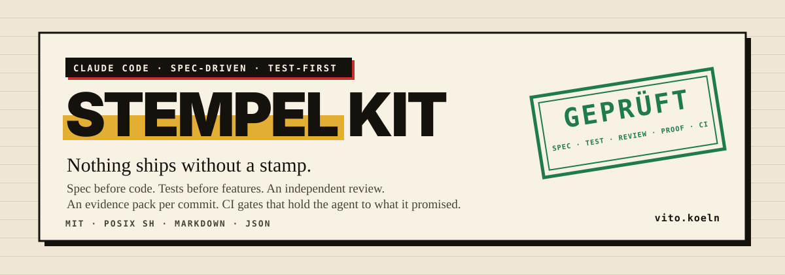
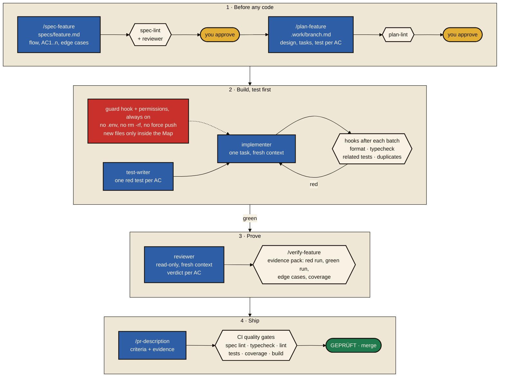

<p align="center">
  <a href="https://github.com/vitoleonardo/stempel-kit"></a>
</p>

<p align="center">
  <a href="https://github.com/vitoleonardo/stempel-kit/actions/workflows/stempel-kit.yml"></a>
  <a href="https://github.com/vitoleonardo/stempel-kit/actions/workflows/stempel-kit-next.yml"></a>
  <a href="https://github.com/vitoleonardo/stempel-kit/actions/workflows/repo-check.yml"></a>
</p>

<p align="center">
  <a href="./plugins/stempel-kit/"></a>
  <a href="./plugins/stempel-kit-next/"></a>
  <a href="./plugins/repo-check/"></a>
  <a href="./LICENSE"></a>
  <a href="https://github.com/vitoleonardo/stempel-kit/commits/main"></a>
</p>

<p align="center">
  <a href="https://code.claude.com/docs"></a>
  
  
  <a href="https://vito.koeln/"></a>
  
</p>

<h1 align="center">Stempel Kit</h1>

<p align="center"><strong>Nothing ships without a stamp.</strong></p>

Claude Code writes code fast. Out of the box, nothing makes it write down what "done" means, test before it builds, keep away from `.env` and `git push --force`, or prove its work before a pull request. Stempel Kit puts the rules, the workflow and the checks into your repository as plain Markdown, JSON and POSIX shell, so every session and every developer works the same way and CI enforces what the agent promised. Built for [Claude Code](https://code.claude.com/docs), MIT licensed.

A *Stempel* is a rubber stamp. Every feature collects five of them before it merges, and each one is a file or a check, not a chat message:

| Stamp | Who sets it | What it proves |
|---|---|---|
| **Spec approved** | `spec-lint`, the reviewer, you | A spec in `specs/` with a user flow and numbered acceptance criteria. Vague words ("fast", "user-friendly") are rejected before anyone approves |
| **Plan approved** | `plan-lint`, you | Every criterion has a task and a named test, new files sit in the Map, nothing is left as a placeholder |
| **Tests red, then green** | `test-writer`, `implementer`, the hooks | Each criterion gets a test that fails first. Format, typecheck, related tests and the duplicates check run after every batch of edits, and the turn does not end quietly while they are red |
| **Review passed** | `reviewer` | A read-only reviewer in a fresh context, with a verdict per criterion and findings by severity |
| **Evidence sealed, CI green** | `/verify-feature`, the quality gates | An evidence pack on the commit: red run, green run, edge-case matrix, coverage of the changed files. CI repeats spec lint, typecheck, lint, tests, coverage, build and duplicates, against a baseline in legacy repositories |

## How it works



Mustard is a person, blue an agent in its own context, the hexagons are hard gates that fail the turn, green is the merge. With `KIT_APPROVAL=standard` the agent pushes and opens the pull request itself unless the branch touches auth or migration files; with `autonomous` it also approves the spec and the plan, and every decision it took is listed in the PR under "Decisions to review". A backlog of approved specs runs unattended with `.claude/bin/autopilot`, one fresh headless session per feature on stacked branches. Bug fixes take the same path through `/fix-bug`, without a spec but with a red test before the fix. The [kit's README](./plugins/stempel-kit/README.md#how-a-feature-flows) walks through one feature step by step.

## What's inside

| | What it is | For |
|---|---|---|
| [**stempel-kit**](./plugins/stempel-kit/) | Plugin and installer | Existing projects in any language: spec-driven workflow, permissions, guard and check hooks, subagents, CI gates, onboarding for legacy repositories with a baseline, model routing with token budgets, lead time measurement, an unattended autopilot. Adapters for TypeScript and Python |
| [**stempel-kit-next**](./plugins/stempel-kit-next/) | Plugin and installer, under test | The kit's next version: one headless session and one stacked pull request per planned group of tasks, e2e and mutation tests once per stack, risk-ranked merges. Install this or the stable kit, never both |
| [**repo-check**](./plugins/repo-check/) | Plugin or single-file prompt | Any repository: finds where delivery is jammed right now (writing, review or release), by a 10-minute interview or a strictly read-only scan. Sends nothing |

### Which one do I need?

- **You want to know where AI agents would help your team most:** start with `repo-check`. It takes ten minutes and changes nothing.
- **You have a codebase and want agents to work in it under rules:** install `stempel-kit`.
- **You want the same rules in many repositories:** install the plugin from the marketplace and the project files with `install.sh --plugin`.

## Quick start

Install the plugins from this repository's marketplace inside Claude Code:

```text
/plugin marketplace add vitoleonardo/stempel-kit
/plugin install repo-check@stempel-kit
/plugin install stempel-kit@stempel-kit
```

`/repo-check` then runs the assessment. The kit also needs its project files (rules, permissions, check commands) in each repository, because plugins cannot ship those:

```sh
git clone https://github.com/vitoleonardo/stempel-kit
cd stempel-kit/plugins/stempel-kit
./install.sh ~/code/my-app --adapter typescript --preset nextjs
```

Without the plugin, `install.sh` installs everything, skills and hooks included. The [kit's README](./plugins/stempel-kit/README.md) covers the options, existing repositories and updates.

Requirements: Claude Code (tested with 2.1.309), git and a POSIX shell. The TypeScript adapter needs Node 20.9+, the duplicates gate [jscpd](https://github.com/kucherenko/jscpd) 5.

> **Renamed.** This repository was `agentic-development-template` and the kit was `agentic-workflow-kit`. Old links redirect and installed plugins keep working. To receive updates under the new name, run `/plugin marketplace remove agentic-development-template`, then the two commands above.

## Repository layout

```text
.claude-plugin/        marketplace: lists every plugin
plugins/
  stempel-kit/         kit/ (what gets installed), adapters/, install.sh, tests/, docs/, examples/demo-app/
  stempel-kit-next/    the kit's next version under test, same layout
  repo-check/          plugin/, the generated single-file prompt repo-check.md, build, tests/, docs/
.github/workflows/     one CI workflow per product
```

## How it is tested

Every product has its own CI workflow that runs on each pull request and on `main`; the badges at the top show the current state:

- **stempel-kit:** shellcheck over every script, fourteen test suites (hooks, spec lint, plan lint, installer, checks and baseline, evidence pack, routing and usage, lead time, run records, autopilot, structure map, status, steering, fix-bug skill), and twelve of them again under `dash`. The demo app is installed with the kit and must pass spec lint, typecheck, lint, tests, coverage and build.
- **stempel-kit-next:** the same suites plus stacked layers and risk rank, and the demo app gates of the next version.
- **repo-check:** shellcheck, the read-only hook, the scanner, and a drift test that fails when the single-file prompt or the bundled `leadtime` differs from its source. All under `dash` as well.

What the tests and real end-to-end runs caught while building each product is in its build log: [kit](./plugins/stempel-kit/docs/build-log.md), [repo-check](./plugins/repo-check/docs/build-log.md). The specifications behind them are next to the logs. Every change to the kit after a real run is in its [improvements log](./plugins/stempel-kit/reports/improvements.md), with the metric it should move and the value before, and `/improve-kit` checks each one after three more runs. What the tools cannot do is under the kit's [limits](./plugins/stempel-kit/README.md#limits).

## Security

The kit's guard hook and permissions reduce risk; they are not a sandbox. See [SECURITY.md](./SECURITY.md) for how to report a vulnerability, and the kit's [limits](./plugins/stempel-kit/README.md#limits).

## Stempel Kit Pro

Everything in this repository stays open source. Teams that work with me also get Stempel Kit Pro, a private add-on for the day the kit runs in every session: a cockpit in Claude Code (status line and pane for the feature, its criteria, red checks, budget, evidence and the autopilot run), playbooks for onboarding, rollout and measurement, and updates for twelve months. It builds on the open kit and removes nothing from it. Details and licensing on [vito.koeln](https://vito.koeln/).

## Support and consulting

These tools come from consulting work on agentic software delivery: workshops in your own repository, pilots, ongoing support and feature sprints with agents.

Not sure whether that fits? Paste [repo-check.md](./plugins/repo-check/repo-check.md) into Claude Code. Ten questions, about ten minutes, nothing is sent; it shows where your delivery is jammed and ends with an email draft you can send or ignore.

- Email: [hi@vito.koeln](mailto:hi@vito.koeln)
- Book a free 20-minute call: [calendar.app.google/N14WVsxK4fdqBhZv6](https://calendar.app.google/N14WVsxK4fdqBhZv6)
- Web: [vito.koeln](https://vito.koeln/)

Bugs and feature requests: [GitHub Issues](https://github.com/vitoleonardo/stempel-kit/issues).

## License

MIT. See [LICENSE](./LICENSE).
