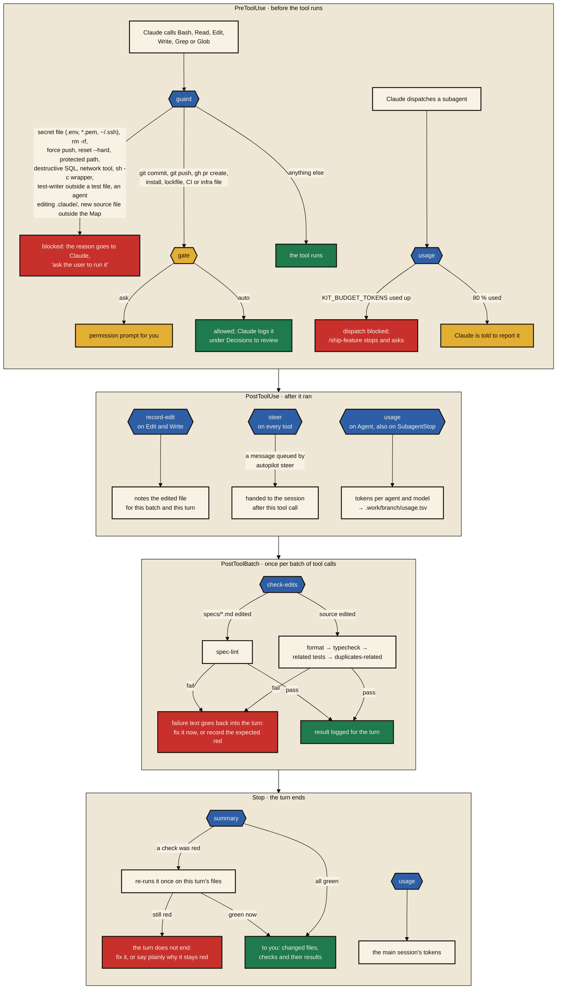

# What the hooks do around every tool call

The skills describe the workflow; the hooks enforce it, in every session, also in a headless one. They are POSIX shell, wired in `.claude/settings.json` (or shipped by the plugin), and they run on Claude Code's hook events:

Three details matter in practice. The guard decides approval gates itself: it answers the permission check with `ask` or `allow` by `KIT_APPROVAL`, so a chained or substituted command (`a && b`, `$(…)`) always goes through the normal prompt. The check hooks run only the commands `.claude/kit.conf` defines, through `.claude/bin/check`, so they are as fast as your typecheck. And a red check does not fail the turn silently: the Stop hook holds the session once, which is why a test written to fail first has to be recorded as such in the state file.

### Hooks and permissions

| Event | Hook | What it does |
|---|---|---|
| `PreToolUse` on Bash, Read, Edit, Write, Grep, Glob | `guard` | Blocks secret files, `rm -rf`, force push, `git reset --hard`, `git clean`, branch deletion, destructive SQL, network tools and the `sh -c`, `/usr/bin/env` and `git -C` wrappers the deny list cannot see. Blocks commands and reads on `KIT_PROTECTED_PATHS`, the test-writer outside test files, agents editing `.claude/`, and a new source file outside the Map. Decides the `commit`, `push`, `deps` and `config` gates by `KIT_APPROVAL` |
| `PreToolUse` on Agent | `usage` | Warns at 80 % of `KIT_BUDGET_TOKENS`, blocks the dispatch at 100 % |
| `PostToolUse` on Edit, Write | `record-edit` | Notes the file for the batch and the turn |
| `PostToolUse` on Agent, `SubagentStop`, `Stop` | `usage` | Reads the transcripts and writes tokens per agent and model to `.work/<branch>/usage.tsv` |
| `PostToolUse` on everything | `steer` | Hands an autopilot session the messages queued with `autopilot steer` |
| `PostToolBatch` | `check-edits` | `spec-lint` for edited specs; format, typecheck, related tests and `duplicates-related` for edited sources; failures go back into the turn |
| `Stop` | `summary` | Re-runs a red check once and holds the turn while it stays red; otherwise reports changed files and check results |

`.claude/settings.json` sets the permissions underneath: read-only git and the kit's own scripts run without asking; `gh pr merge` and edits to `settings.json`, `kit.conf`, the baseline, the hooks, the scripts and the rules always ask, so the agent cannot raise its own level; reading `.env*`, keys and `~/.ssh`, `sudo`, `rm -rf`, force pushes, `curl`, `wget`, `ssh` and `printenv` are denied. For OS-level isolation `/onboard` can turn on Claude Code's sandbox with `denyRead` on protected paths; without it these layers are best effort.
