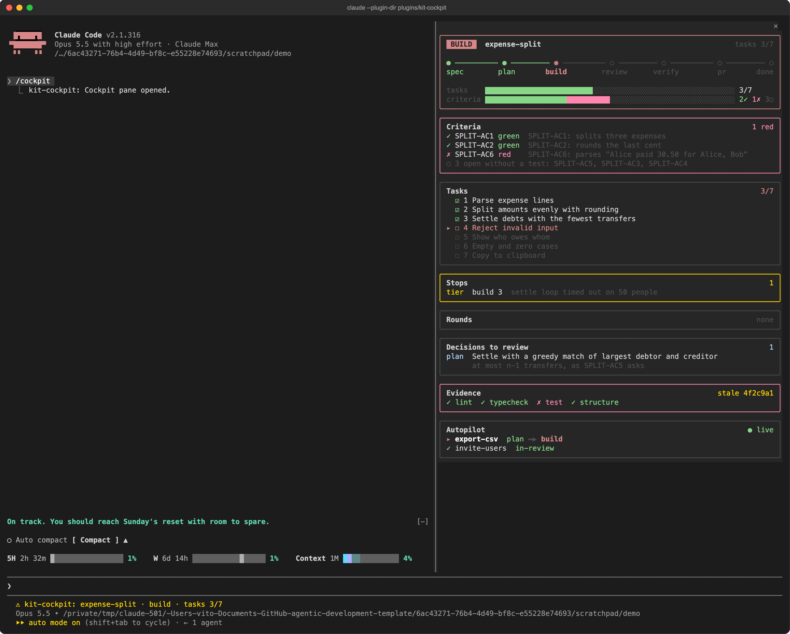
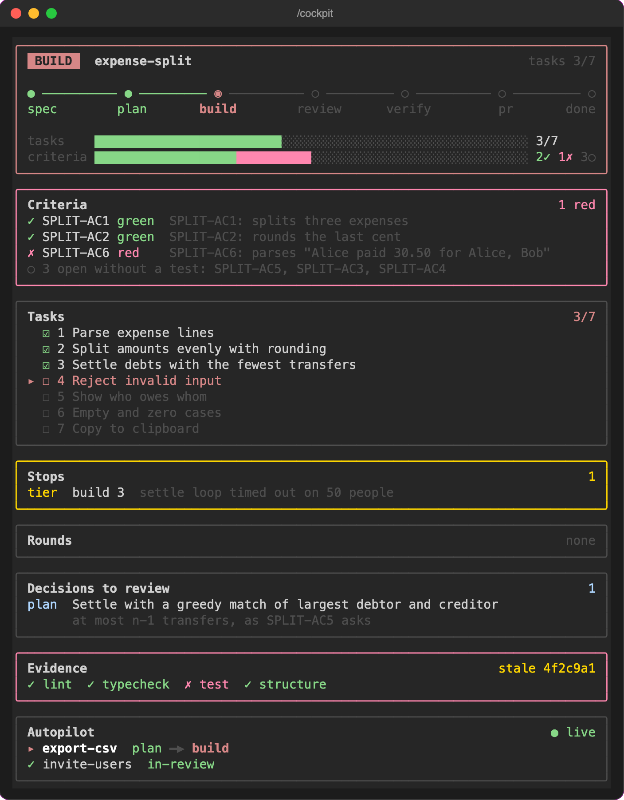

# kit-cockpit

See where the branch's feature stands without opening the state file: a status line under the prompt, and a `/cockpit` pane beside the chat. It reads what the [agentic-workflow-kit](../agentic-workflow-kit/) already writes and changes nothing.



The feature `expense-split` is being built: 3 of 7 tasks done, one criterion red, a stop on record, and an autopilot run building `export-csv` in another terminal.

## Install

Requirements: Claude Code 2.1.316 or newer (the plugin is a hooks module, an early-access API), and the kit 0.3.0 or newer installed in the project, because the cockpit runs its `.claude/bin/status`.

```text
/plugin marketplace add vitoleonardo/agentic-development-template
/plugin install kit-cockpit@agentic-development-template
```

An older kit: run `./install.sh <project> --update` from the kit's repository.

## What it shows

- **Status line**, always on: feature, stage (`spec`, `plan`, `build`, `review`, `verify`, `pr`, `done`), ticked tasks, checks red in this turn, budget used. It refreshes when the session starts, after each Edit, Write and subagent call, and when a turn ends.
- **`/cockpit` pane**: a header, then one panel per section. Colors come from your Claude Code theme, so it works in light and dark.



| Panel | What it tells you |
|---|---|
| Header | The stage as a badge and on the diagram from spec to done; bars for ticked tasks and for green, red and open criteria. |
| Criteria | Each criterion from the Verify log as ✓ green, ✗ red or ○ open, with its test. Open criteria without a test fold into one row. |
| Tasks | ☑ done, ☐ open; `▸` marks the next task. |
| Stops | Each retry or stop with its class, step and trigger. The border turns yellow. |
| Rounds | Review and verify rounds with their result. |
| Decisions to review | What was decided at an automatic gate, and why. |
| Evidence | The gates of the last evidence pack, and `current` or `stale <commit>` against `HEAD`. |
| Autopilot | `● live` or `○ idle`, the feature and phase being worked on, and each finished feature's result. |

A panel's border turns red when it holds something red, and yellow when it holds a stop or a stale pack. An empty panel shrinks to one row with `none`.
- **Folder watch:** while the pane is open, it lists `.work/autopilot` every 5 seconds, which runs no command, and runs the status command only when a file there was added or changed, and once a minute while a run shows as live, so a killed run turns idle. A run started in another terminal shows within 10 seconds; an idle session runs nothing between events.

The pane opens wherever you run `/cockpit`: docked beside the chat in a fullscreen terminal 110 columns wide or more, else above the prompt.

## What it never does

- It writes no file, and the only command it runs is the kit's read-only status command, with a 5-second limit.
- It ticks no task, sets no status and approves no gate. The kit's skills and hooks stay in charge.

When the status command fails or times out, the status line shows `cockpit: error` and the pane shows the reason.

## Development

- Spec: [specs/kit-cockpit.md](../../specs/kit-cockpit.md). The data comes from `.claude/bin/status --json`, documented in the kit's [customizing guide](../agentic-workflow-kit/docs/customizing.md#see-where-a-feature-stands).
- `hooks/register.tsx` wires the events. `hooks/refresh.ts` runs the status command and keeps the snapshot. `hooks/pane.tsx` draws it, with the bar and rail math in `hooks/meters.ts`.
- Tests: `claude plugin test plugins/kit-cockpit` and `claude plugin validate plugins/kit-cockpit`. Both run in CI (`.github/workflows/kit-cockpit.yml`) without a login. For a type check, load the plugin once with `claude --plugin-dir plugins/kit-cockpit`, which writes the API types into `.claude-plugin/types/` (ignored by git), then run `npm exec --package=typescript@5.9.3 -- tsc -p plugins/kit-cockpit`. CI has no such types, so it does not type-check.
